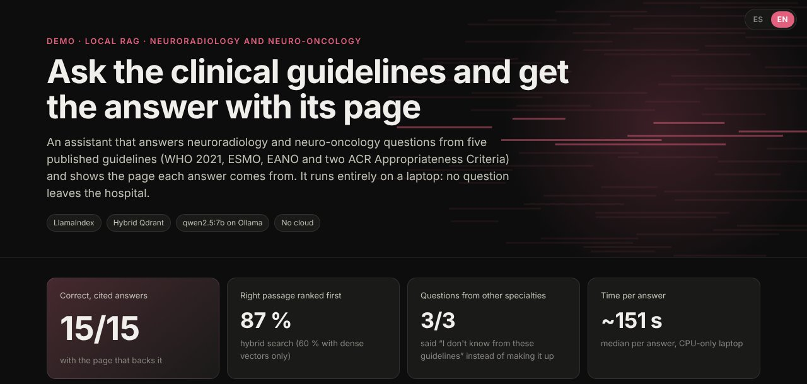

# Med-RAG — on-premise assistant for neuroradiology and neuro-oncology guidelines

**Live dashboard:** [alvaromcib.github.io/Med-RAG](https://alvaromcib.github.io/Med-RAG/) (Spanish) ·
[English](https://alvaromcib.github.io/Med-RAG/en/)

Ask clinical questions in English about five published guidelines (WHO CNS5 2021, ESMO high-grade
glioma, EANO molecular testing, ACR Appropriateness Criteria for cerebrovascular disease and headache) and get a short
answer with the guideline and page it comes from. **Everything runs on a laptop**: parsing, embeddings, vector database
and LLM. No question or document leaves the machine, which is what a hospital needs.

[](https://alvaromcib.github.io/Med-RAG/en/)

*Dashboard: every test question with the model's real answer, the cited pages and the outcome.*

## Results

Single run on a CPU-only laptop with `qwen2.5:7b` (Ollama) and `BAAI/bge-small-en-v1.5`, temperature 0.

| 15 questions answered in the guidelines | |
|---|---|
| correct and cited | 15 |
| **3 questions from other specialties** | **3/3 abstained** |

| Retrieval (top 6 chunks) | 1st | top 6 | MRR |
|---|---|---|---|
| dense only (bge-small) | 60 % | 100 % | 0.77 |
| **hybrid (dense + BM25)** | **87 %** | **100 %** | **0.92** |

Median time per answer: **~151 s** (CPU only). "Correct and cited" means the answer contains the
reference term and at least one of the cited chunks holds the evidence sentence. The test set is small (15 + 3
questions written by hand), so read these numbers as a sanity check, not as a benchmark.

What the numbers don't show:

- **Earlier runs had failures.** With a sixth guideline (NCCN) and three questions on it, the model once abstained
  with the answer in its context (the chunk didn't name the guideline), answered one question from prior knowledge
  with no supporting page, and picked an incomplete figure. Prepending guideline, year and section to every chunk and
  warning when an answer can't be verified are the obvious next steps.
- **NCCN was removed** because its licence forbids using the content as input to AI software. Its three questions
  were replaced by three new ones on the remaining guidelines (ESMO, ACR, EANO) before the final run.
- **One answer key was widened** after an earlier run: "noncontrast head CT" counts as "CT head without contrast".
- **Question 15** is scored correct but adds a gene (H3F3A) that the guideline's list doesn't include.

## Pipeline

1. **Parse** (`src/engine.py`): PyMuPDF (`pymupdf4llm`) turns every page into Markdown, keeping tables such as the
   ACR appropriateness ratings. One document per page with `file_name`, `category` and `page_label`.
2. **Index**: LlamaIndex splits pages into 512-token chunks and stores them in a local **Qdrant** collection with
   dense (`BAAI/bge-small-en-v1.5`) and sparse BM25 (`Qdrant/bm25` via `fastembed`) vectors for **hybrid search**.
3. **Answer**: the 6 best chunks go to **qwen2.5:7b on Ollama** with a prompt that forbids prior knowledge and asks
   to say *"I don't know based on the provided documents"* when the context does not contain the answer.
4. **Evaluate** (`eval/`): 15 questions whose answer and supporting page were checked by hand in the guidelines,
   plus 3 questions from other specialties to check that the assistant abstains.

## Run

```bash
pip install -r requirements.txt
ollama pull qwen2.5:7b            # or set MEDRAG_LLM to another Ollama model
# put the guideline PDFs in data/ (see docs/sources.md: they are copyrighted and not in the repo)
python ingest.py                  # builds ./storage/qdrant_db
python main.py                    # interactive console with streamed answers and sources
python eval/run_eval.py           # evaluation -> results/eval.json
python eval/build_dashboard.py    # dashboard -> docs/
```

On Windows, `scripts/run_local_windows.bat` builds the index and runs the evaluation.

## Notes

- Earlier versions parsed PDFs with LlamaParse (a cloud service). It was replaced by local parsing so that the
  whole pipeline is on-premise.
- This is a demo built on published guidelines, with no patient data. It is a search aid for professionals and does
  not replace clinical judgement or reading the guideline.

---
Álvaro Martín Coll · [Malt](https://www.malt.com/profile/alvaromartincoll) · [GitHub](https://github.com/alvaromcib)
